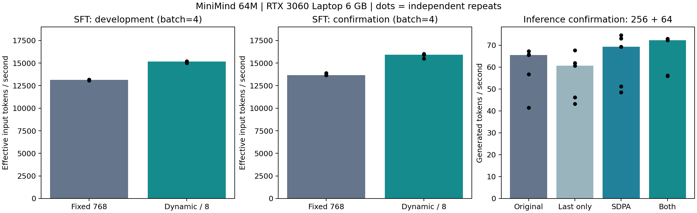
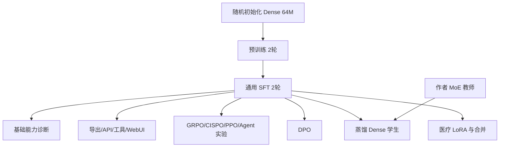

<!-- Modified from jingyaogong/minimind for the 64M training and inference reproduction project. -->

# 64M 语言模型从零训练与推理优化

基于[jingyaogong/minimind](https://github.com/jingyaogong/minimind)搭建64M语言模型从随机初始化、预训练、SFT，到LoRA、偏好优化与本地服务的实验链路；增加动态补齐、缓存解码SDPA、受控性能基准与可追溯交付。结合本机6GB与云端24GB显存完成训练、资源适配、诊断和部署验证。

上游代码基线为 [f659b55761b7](https://github.com/jingyaogong/minimind/blob/f659b55761b754d306bd140573493a6543cafd7f/README.md)。上游源码按 [Apache 2.0](LICENSE) 授权，原项目的说明、致谢和配图可通过固定版本链接查看。



## 从哪里开始

- [过程与产物索引](docs/project/ARTIFACTS.md)：每阶段做了什么、文件在哪里、哪些是自己的成果。
- [运行与复现](docs/project/REPRODUCE.md)：环境、模型获取、推理/API命令、历史训练参数。
- [结果与能力边界](docs/project/RESULTS.md)：曲线、同条件诊断、典型失败与结论范围。
- [效率改进与受控实验](docs/project/EFFICIENCY_EXPERIMENTS.md)：动态补齐约15%有效吞吐提升、缓存解码优化和LoRA部署对照。
- [来源与实际工作](docs/project/PROVENANCE.md)：上游实现、学习注释、辅助程序与个人贡献边界。

## 工作完成

| 阶段 | 工作 | 产物与结论 |
|---|---|---|
| 预训练 | 官方mini数据1,270,238条，Dense约64M，云4090训练2轮 | 自己的预训练权重、续训状态、日志/曲线 |
| SFT | 官方mini数据905,718条，训练2轮 | 自己的通用SFT；后续各分支共同起点 |
| 医疗LoRA | 25,276条，rank16，10轮，393,216个可训练参数 | 适配器、合并模型；验证合并一致性 |
| DPO | 17,166对偏好样本，1轮 | 独立DPO权重 |
| MoE与蒸馏 | MoE机制练习；作者MoE教师、自己的Dense学生 | 蒸馏权重 |
| GRPO/CISPO/PPO/Agent RL | 实际采样、打分和参数更新 | 各分支产物 |
| 工程交付 | 模型导出、HTTP/SSE、工具闭环、WebUI | 本地交互跑通；不是生产级并发服务 |
| 诊断 | 36题×双解码、监督审计、作者权重对照与实现/长度检查 | 明确模型基础能力有限 |
| 效率优化 | 动态裁PAD、单token缓存SDPA、LoRA部署对照，270次推理计时、384次计时更新 | 动态补齐配对吞吐+15.39%/+15.25%；组合推理+13.88%/+10.97%，具体负载见实验报告 |

mini指作者正式发布的快速复现数据版本；前两阶段使用对应文件的全部样本，并非只有几条自造数据。



分支分别从通用SFT开始，没有把全部算法连续叠成一个最终模型。API/WebUI历史展示使用自己的通用SFT。

## 快速体验

先按[运行说明](docs/project/REPRODUCE.md)准备环境，并把**自己的通用SFT**放在`out/full_sft_768.pth`。源码交付不携带权重、数据或虚拟环境，也不会默认替你下载作者模型。

```powershell
.\.venv\Scripts\python.exe -X utf8 tools/project_demo.py --prompt "请介绍一下自己。" --max-new-tokens 128
```

模型约63,912,192个独立参数，hidden768、8层、词表6400。训练采用本机RTX3060 Laptop 6GB和云RTX4090；推理、导出与部分训练可在本机完成。

## 怎样看待效果

可以完成基础问答与工具调用，开放回答有部分相关内容，也有事实错误与重复。这里不报告标准benchmark成绩、医疗可用性或未经验证的提升百分比。

本项目的主要成果是**训练与后训练链路、资源适配、可测量的训练/推理效率改进，以及可追溯的验证与交付**。效率数字来自RTX3060 Laptop特定短程负载，不代表问答准确率提升。
