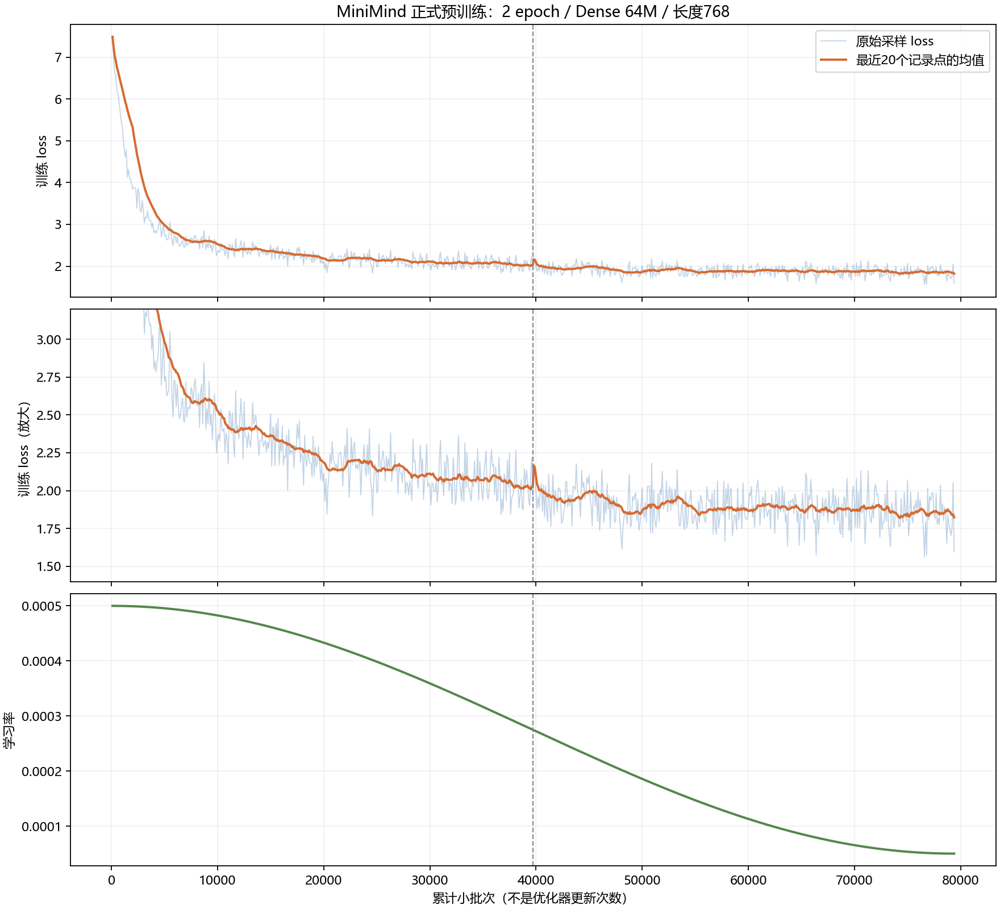
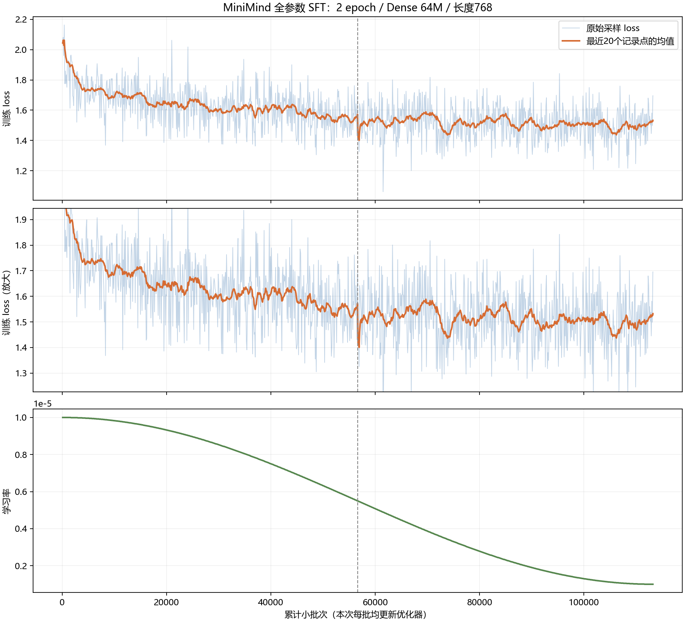
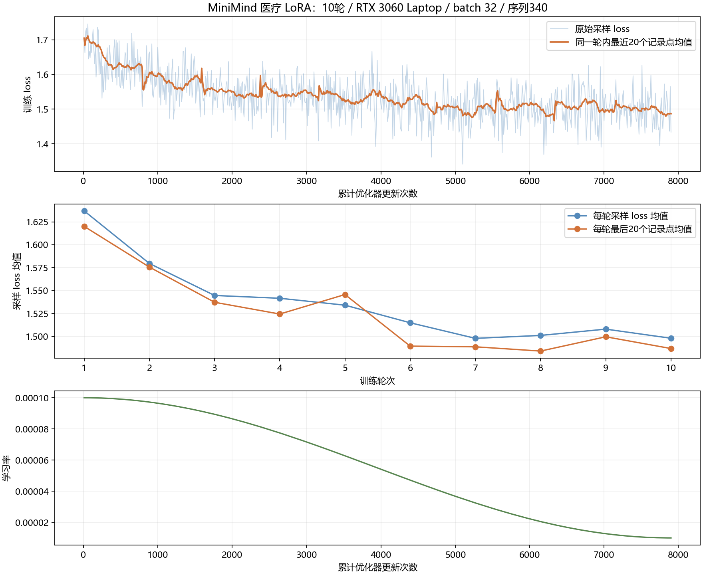
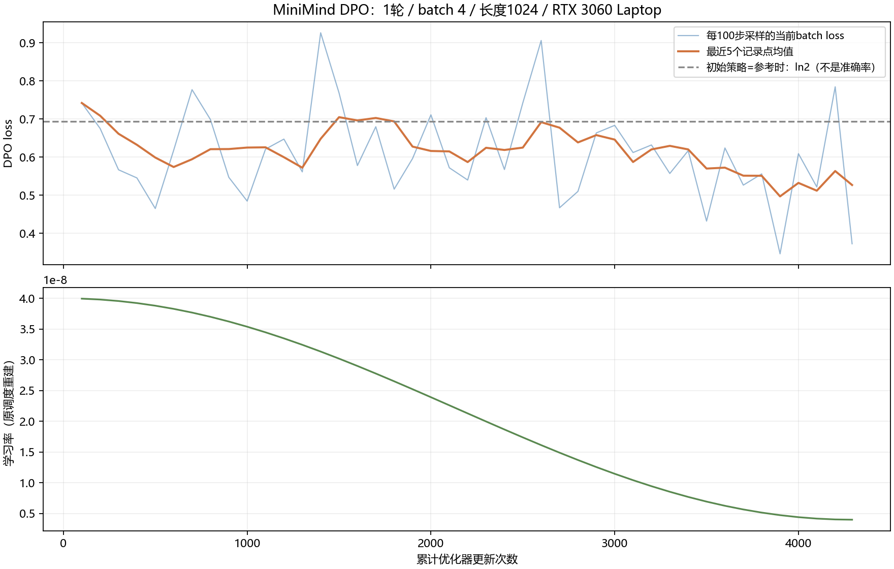

# 实验结果与能力边界

## 完成了什么

预训练、SFT、医疗LoRA和DPO完成约定轮数，权重可加载；LoRA合并与导出路径做过一致性校验。蒸馏及在线RL按用户调整后的短程范围完成，不能称所有算法完整收敛。

| 实验 | 数量与资源记录 | 可支持的结论 |
|---|---|---|
| 预训练 | 2轮，79,390微批次、9,924次更新；云4090约4小时30分实验时段 | 从随机初始化完成下一token训练 |
| SFT | 2轮，113,216次更新；约3小时1分52秒 | 完成对话监督训练 |
| LoRA | 10轮、7,900次更新；本机约46分54秒 | 只更新393,216个适配器参数，领域话题变化可观察 |
| DPO | 1轮、4,292次更新；约34分41秒 | 完成偏好优化流程，不等于独立能力提升已验证 |
| 蒸馏 | 第1轮5,400步主动停止 | 保存部分Dense学生，不是自己的MoE |
| GRPO/CISPO | 各3次更新 | 验证rollout/奖励/优势/参数更新链路 |
| PPO | 3批rollout，Actor/Critic各6次更新 | 验证价值估计及策略更新，非长训练效果结论 |
| Agent RL | 最新一次体验3次更新 | 验证工具交互轨迹、监督掩码和更新 |

不把不同阶段耗时当同预算算法排行榜。日志记录点均值不是独立验证loss，SwanLab记录数也不是更新次数。

## 曲线

对应CSV保留在各图目录。预训练记录点轮均loss约2.4609→1.8901，SFT约1.6376→1.5143；仅描述记录点，不是全token加权均值或准确率变化。

## 基础能力诊断与作者参照

固定36道自建开发题，六类各6题；两种解码各回答一次，seed42、128新token上限。自己的SFT与固定版本作者主线Dense SFT采用相同Tokenizer、模板、实现、精度和生成设置。两模型的指令、推理、上下文严格完成均为0/18，各profile如此。

这个数量要求完整输出符合题意与格式，不代表所有内容都错或通用能力准确率0%。作者sample能给出下一项32、回忆Q7M2，也有水CO2、计算258和首都四川省等实质错误。开放回答由本助手按0/1/2审阅，不是独立人评；两者各有得失，未见稳定整体优势。

六题双模型512token补测没有改善四道严格题完成数；作者同一权重在MiniMind/Qwen3独立实现的四个输入上logits与16token贪心结果一致。数据/标签审计未找到普遍标签错位解释；发现有限的错误监督例子，不能据定向例子推算全数据错误率。

可分享逐题原始回答和固定题集放在本目录`evidence/basic_diagnosis/`。这些题已经用于分析，**不是独立封闭最终测试或公开benchmark**。未知作者完整训练配方，因此不把对照差异全归因于数据规模。

## 工具演示与失败

历史WebUI真实闭环：模型请求`calculate_math({"expression":"78 * 6"})`，程序返回468，模型继续回答468。另有把`(123+456)*7`转成`123+456*7`、工具返回9472而模型复述947的失败记录。格式合法、工具算对、参数符合原题、最终回答忠实是不同层次。

本项目证明训练与交互流程已运行，不承诺医学可用性、稳定复杂推理、所有后训练有效或生产服务能力。基础模型的局限也是项目结论的一部分。
# 新增效率实验（2026-10-31）

在同条件短程对照中，动态补齐有效输入token吞吐配对中位提升15.39%（开发）和15.25%（另一组确认样本）；缓存SDPA＋末位置投影的模型级推理吞吐配对中位提升13.88%/10.97%；医疗LoRA合并部署确认负载提升14.37%。结果、全部波动、数值误差和适用边界见[效率报告](EFFICIENCY_EXPERIMENTS.md)。这是效率指标，不是下方问答质量诊断的分数改善。原正式权重未覆盖。

